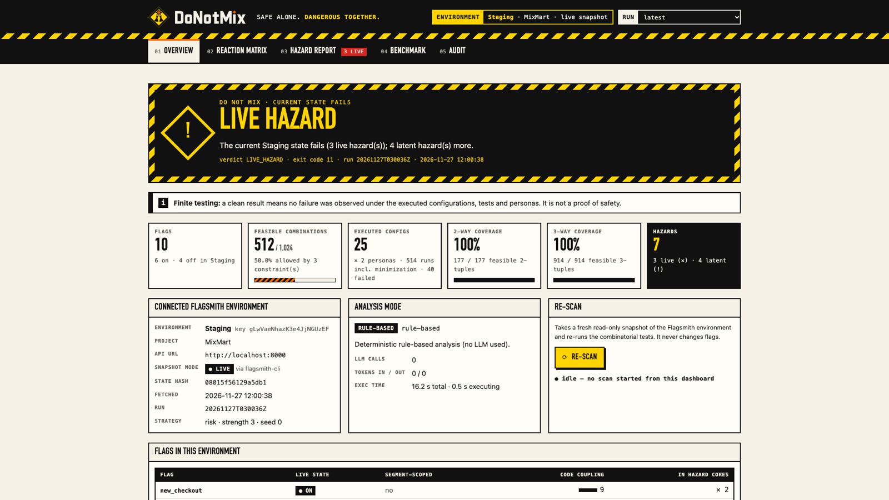
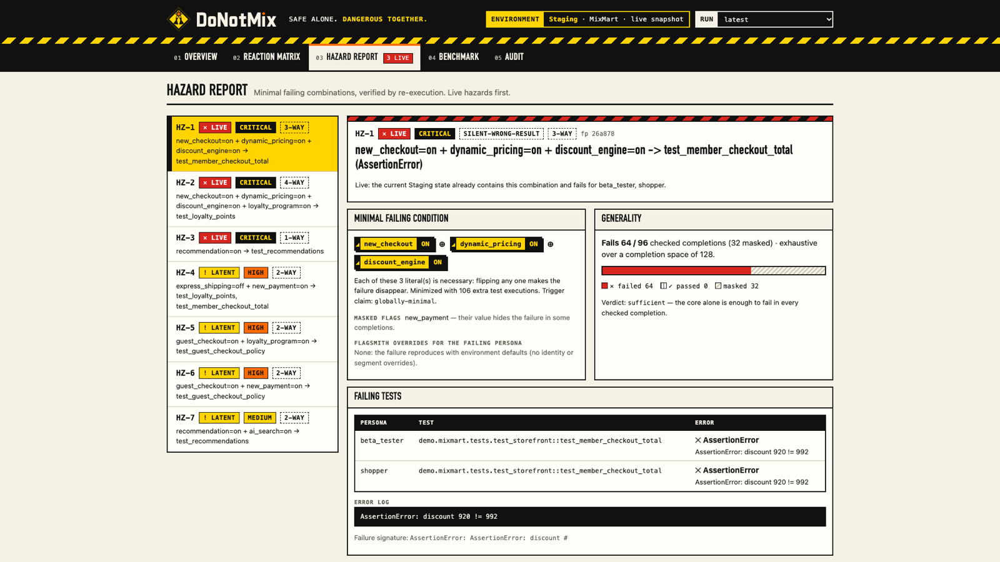
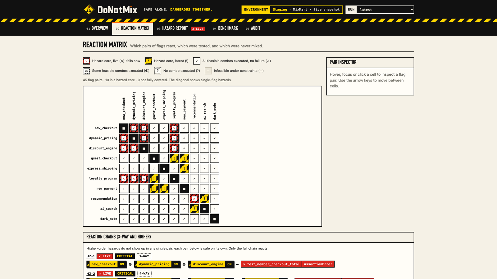
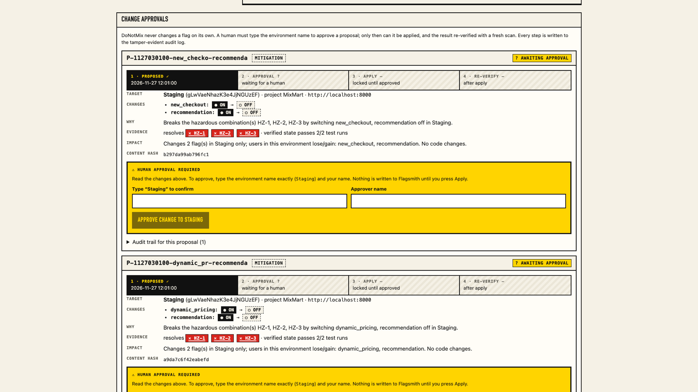

<p align="center">
  
</p>

<h3 align="center">Safe alone. Dangerous together.</h3>
<p align="center"><b>AI-powered combinatorial testing for feature flags, built on Flagsmith.</b><br>
Find the combinations that break your app before your users do.</p>

<p align="center">
  <a href="LICENSE"></a>
  
  
</p>

---

Every flag passes its own tests. `new_checkout` works. `dynamic_pricing` works. `discount_engine` works.
**Switch all three on and checkout charges the wrong amount, with no exception and nothing in the logs.**

DoNotMix reads your **live Flagsmith environment**, runs your **real test suite** over a small, mathematically chosen set of flag combinations, shrinks every failure to the **smallest set of flag values that reproduces it**, and lets a coding agent propose a fix that changes Flagsmith **only after a human approves it**.

```text
$ donotmix scan -e Staging
> snapshot: reading Flagsmith environment (read-only)
> plan: strategy=risk t=3 budget=None seed=0
> self-check: comparing warm pytest workers with fresh processes on 3 states
> execute: 25 configurations x 2 personas, 8 jobs
> minimize: delta debugging + sensitivity + generality checks

  [LIVE_HAZARD] The current Staging state fails (3 live hazard(s)); 4 latent hazard(s) more.
  tested 25 configs x 2 personas | 2-way 100% | 3-way 100% | 514 executions | 16.16s | analysis: rule-based

  HZ-1 LIVE   new_checkout=on + dynamic_pricing=on + discount_engine=on -> test_member_checkout_total (AssertionError)
      core: new_checkout=True, dynamic_pricing=True, discount_engine=True   generality: sufficient (fails 64/96, masked 32, exhaustive)
  HZ-3 LIVE   recommendation=on -> test_recommendations (AssertionError)        <- beta segment only: Flagsmith override turns ai_search on
  HZ-4 LATENT express_shipping=off + new_payment=on -> test_loyalty_points (PaymentError)   <- needs a flag to be OFF
  ...
```
_Real output, trimmed. MixMart, the demo store in this repo, contains intentional bugs (see below)._

| Overview | Hazard Report |
|---|---|
|  |  |
| **Reaction Matrix** | **Human approval gate** |
|  |  |

**Demo video (2:36):** [`docs/demo/out/donotmix-demo.mp4`](docs/demo/out/donotmix-demo.mp4). It is built from real captures by [`docs/demo/build_video.py`](docs/demo/build_video.py), with the script in [`docs/demo/SCRIPT.md`](docs/demo/SCRIPT.md).

## Why feature interactions matter

* With **N** boolean flags there are **2^N** states: 10 flags give 1,024, 20 give over a million, and 30 give more than a billion. Nobody tests them all, and per-flag tests can't see interactions.
* NIST's studies of real failures found that most are triggered by interactions of only **1 to 6 parameters** (Kuhn, Wallace & Gallo 2004). This is the basis of **combinatorial (t-way) testing**: if every combination of any *t* flags is exercised at least once, every fault involving up to *t* flags is triggered.
* Feature flags make this worse. Different teams flip flags at different times, segment overrides give different users different combinations, and the combination you ship has often never run in CI.

## What DoNotMix does

```text
Flagsmith CLI ─► snapshot ─► dependency analysis ─► constraints ─► t-way / risk-weighted test plan
                                                                         │
       report ◄─ explain ◄─ minimize (ddmin + sensitivity + generality) ◄─ run YOUR tests
          │
          └─► propose fix ─► HUMAN APPROVAL ─► apply via Flagsmith CLI (drift-checked) ─► re-verify ─► audit log
```

| Step | What happens | Deterministic? |
|---|---|---|
| **Snapshot** | `flagsmith environment document`, `flag list`, `segment list`, read-only | yes |
| **Constraints** | `requires`, `excludes`, `fixed`, and boolean `rule`s; only feasible states are tested. Contradictory rules are reported with a minimal conflicting subset | yes |
| **Dependency analysis** | AST scan of your code: flags read in the same function, through calls, or guarding writes to the same field form a **hypergraph**, which is used as a risk prior | yes |
| **Plan** | greedy constrained **covering arrays** (2-way, 3-way, t-way), plus a **risk-weighted variable-strength** cover that prioritizes risky hyperedges and changes from the live state | yes, seeded |
| **Execute** | your test command runs once per (state, persona) against a rewritten copy of the environment document, using the **Flagsmith SDK in offline mode**, so segment overrides are evaluated by Flagsmith's own engine | real runs |
| **Minimize** | delta debugging finds the smallest trigger, one-flip sensitivity isolates the **core**, and every completion of the other flags is re-tested to decide whether the core is *sufficient* or only *context-dependent* | real runs |
| **Explain** | rule-based by default; optional LLM (Claude via `claude -p` or the Anthropic API), budget-capped and labelled *unverified* | facts from tests only |
| **Propose / approve / apply** | the smallest **pre-verified** flag change; human approval required; exact-change, drift-checked apply through the Flagsmith CLI; automatic re-scan; hash-chained audit log | yes |

## How Flagsmith is used (it is not optional)

| Flagsmith piece | Role in DoNotMix |
|---|---|
| **Official CLI v2** (`flagsmith`) | The only path to Flagsmith: `auth status`, `environment get`, `flag list`, `environment document`, `segment list`, `evaluate`, and, after approval only, `flag enable/disable --yes`. Every call uses `--json` / `--jq` |
| **Environment document** | The ground truth that gets tested. Candidate states are evaluated against a *copy*; DoNotMix never toggles flags to run a test |
| **Python SDK, offline mode** (`LocalFileHandler`) | The app under test evaluates each candidate state exactly as it would in production, including **segment overrides** |
| **Segments / identities** | *Personas* (identifier + traits) expose bugs that only one segment sees. In the demo, `ai_search` reaches beta users through a segment override |
| **`flagsmith evaluate`** | Integration test proves **parity**: server-side evaluation equals the offline evaluation DoNotMix relies on |
| **Self-hosted Docker** | `docker compose up` brings up Flagsmith, bootstraps it, seeds MixMart through the CLI, scans it and serves the dashboard |
| **Environments** | Production is protected by default; demos and changes target Staging |

Delete Flagsmith and DoNotMix has nothing to test: no states, no segments, no evaluation engine, no change path.

## Quick start

### A. One command (Docker): Flagsmith, demo data, scan and dashboard
```bash
docker compose up --build
```
Open **http://localhost:8765** for the DoNotMix dashboard; Flagsmith runs at http://localhost:8000. The first start creates a local Flagsmith admin with random credentials (kept in the `donotmix-state` volume), seeds the MixMart project **using only the official Flagsmith CLI**, and runs the first scan.

### B. Local development (uv)
```bash
brew install Flagsmith/tap/flagsmith            # or: curl -fsSL https://get.flagsmith.com | sh
uv venv && uv pip install -e ".[dev]"
docker compose -f deploy/flagsmith/docker-compose.yml up -d      # self-hosted Flagsmith on :8000
uv run python scripts/bootstrap_flagsmith.py                     # creates admin + API key in .env, seeds MixMart via CLI
set -a; . ./.env; set +a
uv run donotmix doctor
uv run donotmix scan -e Staging          # exit 11: the live Staging state fails (by design)
uv run donotmix dashboard                # http://127.0.0.1:8765
```

### C. Your own project (Flagsmith Cloud or self-hosted)
```bash
pip install "donotmix @ git+https://github.com/dorakingx/donotmix"
flagsmith login                          # or export FLAGSMITH_API_KEY=<Admin API key>
donotmix init -p "My Project" -e Staging # then edit constraints, personas, runner.command
donotmix scan --dry-run                  # see the plan and coverage first
donotmix scan
```
Your tests must read flags through the Flagsmith SDK in offline mode from `$DONOTMIX_ENV_DOCUMENT`. In Python that is `Flagsmith(offline_mode=True, offline_handler=LocalFileHandler(path))`; see [`demo/mixmart/mixmart/flags.py`](demo/mixmart/mixmart/flags.py) and [`skills/donotmix/references/config.md`](skills/donotmix/references/config.md).

### D. No Flagsmith at all (offline sample)
```bash
uv run donotmix scan --snapshot examples/mixmart-staging.snapshot.json
```
The report says `snapshot: offline-snapshot`; DoNotMix never claims a live connection it didn't make.

## CLI

| Command | Purpose |
|---|---|
| `donotmix init` / `doctor` | create `donotmix.yaml`; check CLI, credentials, environment, runner |
| `donotmix snapshot -e ENV` | read-only snapshot (flags, segments, environment document, state hash) |
| `donotmix analyze` | flag-dependency hypergraph (risk prior) |
| `donotmix scan` | `--strategy exhaustive\|random\|pairwise\|tway\|risk --strength t --budget N --seed S --jobs J --ai rule\|claude-cli\|anthropic --snapshot FILE --dry-run --json --brief` |
| `donotmix reproduce HZ-1` | re-run a hazard's minimal reproduction |
| `donotmix report -f md\|json\|html\|brief` | stored reports (Markdown, self-contained HTML, JSON, compact agent brief) |
| `donotmix propose` | smallest **verified** mitigation for live hazards (changes nothing) |
| `donotmix approve ID` | **human only**: interactive terminal required (or the dashboard) |
| `donotmix apply ID` | approved change only: drift check, exact flags, read-back, re-scan |
| `donotmix rollback ID` / `audit` | inverse proposal (needs approval) / verify the hash-chained audit log |
| `donotmix benchmark` / `dashboard` | reproduce the benchmarks / local dashboard |

**Exit codes for CI:** `0` no failing combination observed · `10` latent hazards (live state passes) · `11` **the live state fails** · `2` usage · `3` config/constraints · `4` Flagsmith (CLI missing, auth, network) · `5` test runner could not run · `6` approval missing/refused/drift. A tooling failure is never reported as "safe".

GitHub Action:
```yaml
- uses: dorakingx/donotmix@main
  with: { environment: Staging, strategy: risk, strength: "3", fail-on: any }
  env: { FLAGSMITH_API_KEY: "${{ secrets.FLAGSMITH_API_KEY }}" }
```

## Agent Skill (Track 04)

[`skills/donotmix/`](skills/donotmix/) follows the [Agent Skills specification](https://agentskills.io/specification) and passes the reference validator (`skills-ref validate skills/donotmix`). It takes a coding agent through the whole job: preflight (CLI + auth) → identify the environment → compact flag state (`flagsmith flag list --jq`) → configure → analyze → plan → scan → read minimized hazards → explain and fix → propose → **ask the human to approve** → apply → re-verify → audit.

```bash
# Claude Code (project scope)
mkdir -p .claude/skills && cp -r skills/donotmix .claude/skills/
# or user scope: cp -r skills/donotmix ~/.claude/skills/
```

**Measured A/B** (Claude Code sub-agents, Sonnet; same task, tools, repository commit and live Flagsmith state; 3 runs per arm; [details](docs/BENCHMARKS.md#e5)):

| | without skill | with skill v2 | change |
|---|---|---|---|
| tokens (harness total) | 79,946 ± 1,916 | 66,764 ± 96 | **-16.5%** |
| tool calls | 5.7 | 3.0 | **-47%** |
| wall time | 90 s | 61 s | **-33%** |
| task completed / no unapproved flag change | 3/3 · 3/3 | 3/3 · 3/3 | |

Skill v1, which spelled out a full 12-step workflow, gave **no** saving (+2.6% tokens). That is why v2 adds `scripts/release_check.sh`, a single call that does preflight, scan and verified proposals and prints one compact JSON object. Other token savers: every Flagsmith call uses `--jq` projections, `hazard.py` extracts one hazard instead of the whole report, and long material sits in `references/`, which loads only on demand. Hard safety rules: the agent never writes flags directly and never runs `approve`.

## Benchmarks (measured, reproducible)

Full tables, method and threats to validity: **[docs/BENCHMARKS.md](docs/BENCHMARKS.md)**. They are generated from raw data by `python -m benchmarks.report`.

**Synthetic suites with hidden ground truth.** 20 evaluation cases per size, with random constraints and planted 2/3/4-way faults (some need a flag *off*) that can mask each other. Seeds 100+ are evaluation; dev seeds are excluded.

| flags | 3-way suite size (100% feasible 3-way coverage) | feasible states (exhaustive) | ≤3-way faults found by 3-way suite |
|---|---|---|---|
| 10 | 18.1 | 768 | 100% |
| 15 | 23.1 | 24,576 | 100% |
| 20 | 27.8 | ~593,101 (counted, not run) | 100% |
| 30 | 34.0 | n/a | 99% |

Same budget (B2 = pairwise suite size, about 8 to 12 tests), share of planted faults detected and NAPFD (higher means earlier):

| flags | random (10 seeds) | pairwise | 3-way (prefix) | **risk (DoNotMix)** |
|---|---|---|---|---|
| 10 | 67% / 0.43 | 83% / 0.51 | 90% / 0.59 | **92% / 0.65** |
| 15 | 72% / 0.45 | 80% / 0.54 | 85% / 0.54 | **93% / 0.65** |
| 20 | 76% / 0.48 | 82% / 0.55 | 83% / 0.51 | **90% / 0.64** |
| 30 | 76% / 0.50 | 85% / 0.59 | 83% / 0.58 | **92% / 0.68** |

**Minimization:** 93 to 99% of reported hazards equal the planted fault exactly, or 98 to 100% when constraint-implied literals are counted, with **0 false positives**. The core averages 2.7 literals; the raw failing state differed from the live state in 8 to 27 flags. Each hazard costs about 60 to 76 extra test runs.

**MixMart (real app, real pytest runs, live self-hosted Flagsmith):** exhaustive testing needs 1,024 executions to expose the 4 planted bugs. `donotmix scan` reaches 100% 2- and 3-way coverage with 25 configurations and matches **all 4 bugs** to minimal cores in about 16 s using the self-checked warm pytest worker. One result goes against us: at the tiny 8-test budget, risk ordering exposed 2/4 bugs on MixMart where pairwise exposed 4/4. Use `--strategy pairwise` for extremely small budgets.

Reproduce: `python -m benchmarks.run --suite full`, `python -m benchmarks.run --suite mixmart`, `python benchmarks/skill_eval.py`.

## Security and human approval

* **Production is read-only.** Protected environments (default `Production`) are refused by `propose`, `approve` and `apply`.
* **No test ever touches Flagsmith state.** Candidate states live in local copies of the environment document.
* **Agents can't approve.** `donotmix approve` requires an interactive terminal; the dashboard requires the environment name to be typed, an approver name, a CSRF token and a localhost origin.
* **Exactly what was approved.** The approval binds to a hash of the proposal. Apply refuses edited proposals, re-reads live state and aborts on drift, writes only the approved flags, reads each one back, then re-scans.
* **Tamper-evident audit log.** `.donotmix/audit.jsonl` is a hash chain covering proposed → approved → applied → reverified (`donotmix audit`).
* Secrets stay in environment variables (`.env` is git-ignored; see `.env.example`). The optional LLM receives trimmed evidence only: core, test names, error messages and a few code snippets. It never receives credentials or the environment document.

## Limitations (honest)

* Finite testing is not proof. A clean scan means no failure was observed for the tested states, personas and tests.
* Flags are treated as booleans (enabled state). Multivariate values are supported by the engine but not yet read from Flagsmith variants.
* The risk prior is a heuristic. It helped on average in the synthetic study, but not on MixMart at the smallest budget.
* Masking (one bug hiding another in the same test) is detected and reported as *unresolved*, never as a pass. Heavily masked failures may stay unminimized.
* Runtime is dominated by your test suite: MixMart takes about 0.5 s per run, parallelized with `--jobs`.
* `approve` requiring a TTY is a safeguard against autonomous agents, not a security boundary against a malicious local user.

## Prior art: what is new and what is not

Covering arrays and greedy one-test-at-a-time construction (AETG, Cohen et al. 1997; IPOG; NIST ACTS; Microsoft PICT), prioritized interaction testing (Bryce & Colbourn 2006), variable-strength arrays, delta debugging (Zeller & Hildebrandt 2002), and feature-interaction research on software product lines are all **established techniques that DoNotMix reuses, not inventions**. What DoNotMix adds is the closed loop around them:

1. live Flagsmith state, including segment overrides through the real SDK
2. code-derived risk hypergraphs
3. real test execution
4. minimization with explicit, separate claims about sufficiency and minimality
5. verified mitigations behind human approval and an audit log
6. an Agent Skill that runs all of this token-efficiently

## Project layout

```
src/donotmix/        engine: space.py (constraints), generate.py (covering arrays), analysis.py (risk),
                     runner.py, minimize.py (ddmin), engine.py, flagsmith.py (CLI adapter), approval.py,
                     remediate.py, ai.py, report.py, cli.py, dashboard.py (+ dashboard_static/, brand/)
demo/mixmart/        demo storefront with INTENTIONAL bugs + its pytest suite and oracle
benchmarks/          synthetic generator, harness, MixMart benchmark, skill A/B eval, results/
skills/donotmix/     Agent Skill (SKILL.md, scripts/, references/)
deploy/flagsmith/    self-hosted Flagsmith compose;  docker-compose.yml = full one-command stack
tests/               unit tests (no credentials) + tests/integration (live Flagsmith, DONOTMIX_IT=1)
```

**Why this stack:** Python for the engine (ast for analysis, a small custom CSP solver that handles feasibility checks in microseconds, no heavy solver dependency); Typer and Pydantic for the CLI and config; FastAPI with a no-build vanilla JS dashboard that is light enough for a laptop; Docker Compose for one-command self-hosting.

## MixMart: intentional bugs

`demo/mixmart` is a toy storefront written for this demo. It **deliberately contains feature-interaction bugs**: a 3-way discount and pricing bug that silently produces a wrong total, a 2-way guest and loyalty crash, a bug that needs `express_shipping` to be *off*, and an ID-format bug that one Flagsmith segment receives through an override. Do not reuse its code. It uses no real payments and no personal data. The ground truth lives only in `benchmarks/ground_truth/` and is never read by the engine.

## Roadmap

Multivariate and remote-config values · Flagsmith change requests as the approval path for Enterprise · persistent test workers for faster suites · JS/TS runners · smarter masking resolution · a contribution to the official Flagsmith skills catalog.

## Hackathon

Built for **Toggle Wars: The Flagsmith Experimentation Hackathon** (WeMakeDevs × Flagsmith, November 2026). Tracks: **02 AI Agents and Feature Flags**, **04 Flagsmith Agent Skills**, **03 Build on Open Source Flagsmith**.

## License

[Apache-2.0](LICENSE). Flagsmith is a trademark of its owners; DoNotMix is an independent project. `deploy/flagsmith/docker-compose.yml` is derived from Flagsmith's BSD-3-Clause compose file.
